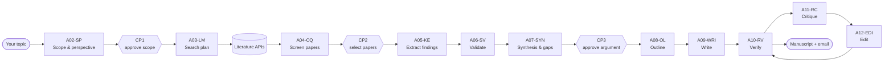

# Literature Review Multi-Agent System

A multi-agent pipeline that helps a researcher draft a **narrative literature review** for
*Scientific Reviews* (Nature Portfolio). Eleven LLM agents (Claude and OpenAI) search, screen,
extract, validate, synthesize, write, verify, critique and edit — while **the researcher makes
every scholarly decision** at three checkpoints, as the journal's AI policy requires.

> **Status:** first draft (v0.1). Prompts complete; pipeline runnable end to end with some tools
> still marked `TODO` (see [docs/development_plan.md](docs/development_plan.md)).

## How it works



See [docs/architecture.md](docs/architecture.md) for the full design.

## Repository map

| Folder | What's in it |
|---|---|
| [`prompts/`](prompts/) | The agent prompts — **start here** to understand what each agent does. [`prompts/README.md`](prompts/README.md) indexes them. |
| &nbsp;&nbsp;`prompts/shared/` | Rules every agent follows (`core_rules.md`) and the writing rules for writer, verifier, critic and editor (`language_policy.md`) |
| &nbsp;&nbsp;`prompts/agents/` | One prompt per agent, `A02` to `A12`, in pipeline order |
| [`config/`](config/) | Everything you change between runs — no code edits needed |
| &nbsp;&nbsp;`pipeline.yaml` | Which model runs each agent, spend cap, loop limits, checkpoints, email events |
| &nbsp;&nbsp;`prices.yaml` | Model prices for the budget monitor (fill in before first run) |
| &nbsp;&nbsp;`sources.yaml` | Literature databases on/off, and identifier lookup services |
| &nbsp;&nbsp;`journal_scirev.yaml` | *Scientific Reviews* limits and rules |
| [`schemas/`](schemas/) | JSON schemas each agent's output is validated against |
| [`src/litreview/`](src/litreview/) | The Python package |
| &nbsp;&nbsp;`orchestrator.py` | The pipeline: stages, checkpoints, loops (deterministic — no AI judgement) |
| &nbsp;&nbsp;`agents/` | Loads prompts, calls models, validates output |
| &nbsp;&nbsp;`llm/` | Claude and OpenAI API wrappers |
| &nbsp;&nbsp;`tools/` | Deterministic tools: literature search, deduplication, span checking, compliance, references, full text |
| &nbsp;&nbsp;`budget.py` · `provenance.py` · `checkpoints.py` · `notify.py` | Cost cap, decision log, human review files, email |
| [`tests/`](tests/) | Unit tests (`pytest`) |
| [`docs/`](docs/) | Architecture, checkpoints guide, 2-week plan, prompt lineage |
| `runs/` | One folder per run (gitignored): inputs, outputs, checkpoints, costs, final manuscript |

## Quick start

```bash
# 1. Install (Python 3.10+)
python -m venv .venv && source .venv/bin/activate      # Windows: .venv\Scripts\activate
pip install -r requirements.txt && pip install -e .

# 2. Configure
cp .env.example .env            # add API keys and SMTP settings
#    edit config/pipeline.yaml  -> set the OpenAI model IDs (openai_default, openai_strong)
#    edit config/prices.yaml    -> add current prices for every model you use
#    edit config/sources.yaml   -> enable/disable databases
litreview check                 # everything should show ✓

# 3. Run
litreview new --topic my_topic.md --notes my_notes.md --seeds seed_dois.txt
litreview run <run_id>          # stops at each checkpoint and emails you
litreview approve <run_id> CP1  # after filling in runs/<run_id>/checkpoints/CP1_decision.json
litreview run <run_id>          # continue; repeat for CP2 and CP3
litreview status <run_id>       # stage, status and spend at any time
```

The finished draft is written to `runs/<run_id>/final/manuscript.md`, with `compliance.json`,
`costs.txt` and `provenance_summary.json`, and emailed to you.

## What stays human

- **Perspective and scope** (CP1), **which papers are used** (CP2, every paper shown), and the
  **thesis and conclusions** (CP3). Agents only propose.
- Author contributions and biographies, the AI-use disclosure, competing interests, the cover letter.
- `runs/<run_id>/provenance.jsonl` records every agent call and every human decision, as the
  source for the AI disclosure and contribution statement.

## Tests

```bash
pytest
```
